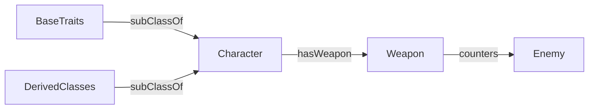

# Отчёт по модулю 1

Университет ИТМО. Системы искусственного интеллекта.
Модуль 1. Базы знаний и онтологии. Тема: подбор персонажа фэнтезийной RPG.
Выполнил: Бирюков Ян; группа: 3321; проверила: Королева Ю.А.
Санкт-Петербург, 2026.

# 2. Аннотация

В работе разработана система поддержки принятия решений для выбора персонажа вымышленной фэнтезийной RPG. Предметная область представлена базой знаний Prolog, содержащей 50 унарных фактов, 15 бинарных фактов и семь правил. Факты и правила перенесены в онтологию OWL/SWRL с иерархией классов, типизированными свойствами и ограничениями. Онтология проверена средствами HermiT и Pellet, а результаты вывода сопоставлены с ответами Prolog. Консольная DSS принимает строку фиксированного формата, уточняет недостающие данные и объясняет рекомендации. Работоспособность подтверждена автоматическими тестами, компетентностными запросами и пятью сценариями использования.

## 3. Введение

Цель модуля - освоить логическое моделирование, построение онтологий, проверяемый вывод и применение знаний в системе поддержки принятия решений (DSS). Последовательность работы: БЗ Prolog → онтология OWL/SWRL → диалоговое приложение.

Базы знаний отделяют сведения о предметной области от интерфейса. Это позволяет повторно использовать факты, проверять вывод и объяснять рекомендации. Онтология дополнительно задает общую терминологию, иерархию и ограничения согласованности данных.

Выбран домен игровых персонажей. Пользователь задает роль, дистанцию боя, опыт и тип противника; система возвращает все подходящие архетипы. Игровые характеристики являются авторскими допущениями учебной модели и не описывают баланс коммерческой игры.

Нумерация соответствует присланному шаблону: Prolog и онтология - ЛР1, части 1 и 2; DSS - ЛР2. Каталоги lab1, lab2 и lab3 сохранены для совместимости с ранее подготовленными исходниками.

Отчет содержит по три страницы на каждый практический раздел, две страницы тестирования, отдельные разделы оценки и заключения. Фактические журналы приложены в архиве.

# 4. База знаний в Prolog ЛР1, часть 1: дизайн и реализация

## 4.1. Сущности и отношения

Каталог содержит десять архетипов. Роли «урон», «защита», «поддержка» совместимы. Дистанция в этой модели одна: ближняя либо дальняя. beginner/1 означает подтвержденную пригодность новичку; отсутствие факта не доказывает объективную сложность.

| Персонаж | Роли | Дистанция | Новичок | Оружие |
|---|---|---|---|---|
| warrior | урон, защита | ближняя | да | sword |
| paladin | урон, защита, поддержка | ближняя | да | sword |
| guardian | защита | ближняя | да | mace |
| ranger | урон | дальняя | да | bow |
| assassin | урон | ближняя | нет факта | dagger |
| mage | урон | дальняя | нет факта | staff |
| cleric | поддержка | ближняя | да | mace |
| druid | урон, поддержка | дальняя | нет факта | staff |
| bard | поддержка | дальняя | да | bow |
| necromancer | урон | дальняя | нет факта | staff |

Русские названия: warrior - воин; paladin - паладин; guardian - страж; ranger - следопыт; assassin - ассасин; mage - маг; cleric - жрец; druid - друид; bard - бард; necromancer - некромант.

| Предикат | Назначение |
|---|---|
| character/1 | Множество доступных персонажей |
| melee/1, ranged/1 | Дистанция боя |
| damage/1, tank/1, support/1 | Игровая роль |
| beginner/1 | Пригодность новичку |
| weapon/1, enemy/1 | Словари оружия и противников |
| has_weapon/2 | Основное оружие персонажа |
| counters/2 | Эффективность оружия против противника |

Связи оружия: sword → beast; bow → flying; staff → armored; dagger → caster; mace → undead. Это правила выбранной учебной игры.

# 4. База знаний в Prolog Структура и правила

## 4.2. Требования и организация файлов

| Элемент | Требуется | Выполнено |
|---|---|---|
| Унарные факты | не менее 20 | 50 |
| Бинарные факты | 10-15 | 15 |
| Правила | 5-7 | 7 |
| Примеры запросов | 6-10 | 10 |

knowledge_base.pl разделен комментариями на сущности, признаки, словари, отношения и правила. Запросы вынесены в queries.pl, тесты - в tests/knowledge_base_tests.pl. Разделение позволяет запускать примеры и тесты независимо от приложения.

Состав унарных фактов: character - 10; melee и ranged - по 5; damage - 7; tank - 3; support - 4; beginner - 6; weapon и enemy - по 5. Бинарные факты: 10 has_weapon и 5 counters.

## 4.3. Полный набор правил

```
frontliner(X) :- melee(X), tank(X).
protector(X) :- frontliner(X), support(X).
ranged_damage(X) :- ranged(X), damage(X).
beginner_choice(X) :- character(X), beginner(X).
armored_hunter(X) :- damage(X), has_weapon(X, W), counters(W, armored).
ranged_support(X) :- ranged(X), support(X).
versatile(X) :- damage(X), support(X).
```

## 4.4. Композиция и отрицание

Для protector(paladin) сначала доказывается frontliner(paladin): нужны melee(paladin) и tank(paladin). Затем проверяется support(paladin). Все три факта есть, поэтому паладин попадает в результат. Это композиция правил R1 и R2.

Конъюнкция задается запятой, дизъюнкция - точкой с запятой. Отрицание как неуспех \+ используется в запросе после character(X), когда X уже связан. Положительные правила переносятся в SWRL; отрицание не подменяет отсутствие знания логическим отрицанием в OWL.

# 4. База знаний в Prolog Запросы и фактические ответы

Ниже приведены десять запросов и ответы SWI-Prolog. Скрипт собирает ответы findall/3 и устраняет повторы sort/2. Поэтому Q4 содержит паладина один раз, хотя он удовлетворяет обеим ветвям.

```
Q1: character(X).
[assassin,bard,cleric,druid,guardian,mage,
 necromancer,paladin,ranger,warrior]
Q2: has_weapon(X, staff).
[druid,mage,necromancer]
Q3: tank(X), support(X).
[paladin]
Q4: (tank(X); support(X)).
[bard,cleric,druid,guardian,paladin,warrior]
Q5: character(X), \+ beginner(X).
[assassin,druid,mage,necromancer]
Q6: protector(X).
[paladin]
Q7: armored_hunter(X).
[druid,mage,necromancer]
Q8: ranged_damage(X), beginner_choice(X).
[ranger]
Q9: ranged_support(X), has_weapon(X,W).
[bard-bow,druid-staff]
Q10: tank(X), ranged(X).
[]
```

Q1-Q2 обращаются к фактам и отношениям; Q3-Q5 демонстрируют И, ИЛИ и НЕ; Q6-Q8 требуют логического вывода; Q9 связывает две переменные; Q10 демонстрирует отсутствие решения. Порядок строк - от прямого поиска к составным условиям и правилам.

```
swipl -q -s lab1/queries.pl -g main -t halt
```

Источник фактических ответов: evidence/prolog_queries.txt. БЗ проверена 14 тестами PL-Unit. У каждого персонажа ровно одно основное оружие и одна дистанция; все связи ведут к объявленным объектам.

# 5. Онтология в Protégé ЛР1, часть 2: моделирование

Исходные факты переведены в OWL/RDF-XML. Созданы 16 классов, 20 предметных индивидов, два ObjectProperty, один DataProperty и семь правил SWRL. Иерархия имеет три уровня с учетом owl:Thing: Thing → Character → конкретный признак или выводной класс.



## 5.1. Мини-матрица трассируемости

| Prolog | OWL-элемент | Комментарий |
|---|---|---|
| character(paladin). | paladin rdf:type Character | Индивид и его класс |
| melee(paladin). | paladin rdf:type Melee | Melee subClassOf Character |
| beginner(paladin). | Beginner; beginnerFriendly true | Класс + литерал xsd:boolean |
| has_weapon(paladin,sword). | paladin hasWeapon sword | Character → Weapon |
| counters(sword,beast). | sword counters beast | Weapon → Enemy |
| protector(X) :- ... | Protector и правило R2 | Результат выводится reasoner |

beginnerFriendly - дополнительное представление того же факта beginner/1 литералом true типа xsd:boolean. Оно не вводит новые сведения о персонаже. Для остальных четырех персонажей значение не задано; false из отсутствия факта не выводится.

OWL создается скриптом lab2/build_ontology.py; факты читаются из БЗ, а перевод семи правил описан явно. Исходный rpg.owl не содержит заранее присвоенных выводных классов.

# 5. Онтология в Protégé Свойства, ограничения и SWRL

| Свойство | Домен / диапазон | Ограничение |
|---|---|---|
| hasWeapon | Character / Weapon | Functional; exactly 1 |
| counters | Weapon / Enemy | Для Weapon: min 1 |
| beginnerFriendly | Character / xsd:boolean | Functional; значение true у 6 индивидов |

```
Character SubClassOf hasWeapon exactly 1 Weapon
Weapon SubClassOf counters min 1 Enemy
```

Character, Weapon и Enemy попарно disjoint; Melee и Ranged также disjoint. Роли Damage, Tank и Support совместимы. Все 20 предметных индивидов объявлены различными (AllDifferent), чтобы два разных оружия нельзя было неявно отождествить при проверке cardinality.

В открытом мире отсутствие явно записанной связи не всегда вызывает ошибку: reasoner может допускать неизвестное значение. Поэтому фактическое наличие одного оружия отдельно проверяется тестами Prolog. Ограничения OWL проверяют логическую согласованность.

## 5.2. Семь правил SWRL

```
R1: Melee(?x), Tank(?x) -> Frontliner(?x)

R2: Frontliner(?x), Support(?x) -> Protector(?x)

R3: Ranged(?x), Damage(?x) -> RangedDamage(?x)

R4: Character(?x), Beginner(?x) -> BeginnerChoice(?x)

R5: Damage(?x), hasWeapon(?x, ?w),
  counters(?w, armored) -> ArmoredHunter(?x)

R6: Ranged(?x), Support(?x) -> RangedSupport(?x)

R7: Damage(?x), Support(?x) -> Versatile(?x)
```

Правила R1-R7 соответствуют семи правилам Prolog. SWRL-импликация задает достаточное условие принадлежности классу; она не является объявлением эквивалентности класса.

# 5. Онтология в Protégé Компетентностные запросы и проверки

| № | Компетентностный вопрос | Ожидаемый и полученный ответ |
|---|---|---|
| C1 | Какие персонажи доступны? | Все 10 персонажей |
| C2 | Кто наносит урон на расстоянии? | druid, mage, necromancer, ranger |
| C3 | Кто защищает и поддерживает? | paladin |
| C4 | Кто атакует бронированных? | druid, mage, necromancer |
| C5 | Кто подойдет новичку для дальней атаки? | ranger |
| C6 | У кого beginnerFriendly = true? | bard, cleric, guardian, paladin, ranger, warrior |

```
PREFIX rpg: <https://example.org/rpg-labs#>
PREFIX rdfs: <http://www.w3.org/2000/01/rdf-schema#>
# Перед каждым запросом используются эти префиксы.
# C1
SELECT DISTINCT ?x WHERE {
  ?x a/rdfs:subClassOf* rpg:Character
} ORDER BY ?x
# C2
SELECT ?x WHERE { ?x a rpg:RangedDamage } ORDER BY ?x
# C3
SELECT ?x WHERE { ?x a rpg:Protector } ORDER BY ?x
# C4
SELECT ?x WHERE {
  ?x a rpg:Damage; rpg:hasWeapon ?w.
  ?w rpg:counters rpg:armored
} ORDER BY ?x
# C5
SELECT ?x WHERE {
  ?x a rpg:RangedDamage, rpg:BeginnerChoice
} ORDER BY ?x
# C6
SELECT ?x WHERE { ?x rpg:beginnerFriendly true } ORDER BY ?x
```

Шесть запросов выполнены через RDFLib над rpg_inferred.owl; все ответы совпали с ожидаемыми. HermiT и Pellet независимо запущены на исходном rpg.owl: онтология согласована, все семь наборов выводных типов совпали с Prolog.

Файл подходит для открытия в Protégé; сценарий GUI-проверки приведен в lab2/PROTEGE.md. HermiT запускался программно, а сам GUI Protégé не проверен из-за блокировки установки Gatekeeper. Скриншоты редактора не заявляются.

# 6. DSS на базе знаний ЛР2: архитектура и реализация

## 6.1. Формат ввода и конвейер

```
роль=урон; дистанция=дальняя

Уточнение 1: Ваш опыт? новичок
Уточнение 2: Основной противник? любой
```

Роль и дистанция обязательны. Поля опыт и противник можно сразу включить в строку или сообщить в ходе диалога. Если отсутствует одно поле, задается один вопрос; если оба - два. Для полной строки запрашивается подтверждение выдачи результата. Рекомендация не выдается до завершения диалога.

| Поле | Допустимые значения |
|---|---|
| роль | урон / защита / поддержка |
| дистанция | ближняя / дальняя / любая |
| опыт | новичок / опытный |
| противник | любой / зверь / летающий / бронированный / маг / нежить |

```
ПРОЧИТАТЬ строку ключ=значение; ключ=значение
РАЗОБРАТЬ поля; проверить ключи, значения и дубликаты
НОРМАЛИЗОВАТЬ регистр, пробелы и «ё»
ЕСЛИ нет опыта или противника: задать 1-2 уточнения
ЕСЛИ все поля есть: подтвердить выдачу рекомендации
СФОРМИРОВАТЬ конъюнкцию предикатов Prolog
ВЫПОЛНИТЬ запрос в SWI-Prolog, получить JSON
УДАЛИТЬ дубликаты; сохранить всех допустимых кандидатов
ВЫВЕСТИ персонажей, оружие и доказанные свойства
```

Система выполняет точный отбор по обязательным условиям. Агрегация - findall/3 и sort/2: повторы удаляются, возвращаются все совпадения без оценочного ранжирования. Сортировка имеет технический смысл и не означает, что первый персонаж лучше.

Python управляет диалогом и отображает ответ. Предметные признаки и выводы запрашиваются у Prolog. Подпроцесс запускается без shell; значения проходят белые списки. JSON содержит идентификатор, оружие и свойства, доказанные семью правилами.

```
python3 lab3/app.py --fixed
```

Также сохранен простой режим с четырьмя отдельными вопросами: python3 lab3/app.py.

# 6. DSS на базе знаний Сценарии 1-3

## 6.2. Сценарий 1

Вход: роль=урон; дистанция=дальняя. Уточнения: новичок; любой.

```
character(X),damage(X),ranged(X),beginner_choice(X),has_weapon(X,W).
```

Фактическая рекомендация: ranger. Следопыт удовлетворяет damage, ranged и beginner_choice; его оружие - лук. Остальные дальние атакующие в БЗ не имеют подтверждения пригодности новичку.

## 6.3. Сценарий 2

Вход: роль=поддержка; дистанция=дальняя. Уточнения: опытный; любой.

```
character(X),support(X),ranged(X),has_weapon(X,W).
```

Фактическая рекомендация: bard, druid. Бард и друид обладают support и ranged. Опытный игрок не ограничивает выбор предикатом beginner_choice. У барда лук, у друида посох.

## 6.4. Сценарий 3

Вход: роль=урон; дистанция=дальняя. Уточнения: опытный; бронированный.

```
character(X),damage(X),ranged(X),has_weapon(X,W),counters(W,armored).
```

Фактическая рекомендация: necromancer, druid, mage. Друид, маг и некромант наносят урон издалека, имеют посох; counters(staff,armored) подтверждает эффективность против выбранного противника.

Данные примеров получены реальными вызовами recommend и диалогового режима --fixed. Машиночитаемая запись: evidence/dss_scenarios.json; полные журналы: evidence/dialog_beginner.txt, dialog_support.txt, dialog_armor.txt.

# 6. DSS на базе знаний Сценарии 4-5 и нештатные ситуации

## 6.5. Сценарий 4

Вход: роль=поддержка; дистанция=любая. Уточнения: новичок; нежить.

```
character(X),support(X),beginner_choice(X),has_weapon(X,W),counters(W,undead).
```

Фактическая рекомендация: cleric. Жрец имеет роль поддержки и beginner_choice. Его булава удовлетворяет counters(mace,undead). Дистанция не ограничена.

## 6.6. Сценарий 5

Вход: роль=защита; дистанция=дальняя. Уточнения: новичок; любой.

```
character(X),tank(X),ranged(X),beginner_choice(X),has_weapon(X,W).
```

Фактическая рекомендация: нет решений. Все защитники в каталоге относятся к ближнему бою, поэтому совместный запрос tank и ranged не имеет решений. Система сообщает об отсутствии совпадений и предлагает при повторном запуске выбрать любую дистанцию; самовольно запрос не ослабляет.

## 6.7. Ошибки входа и конфликт признаков

| Ситуация | Поведение |
|---|---|
| Неизвестная роль: роль=маг | Ошибка словаря; ввод строки повторяется |
| Нет обязательной дистанции | Сообщение об обязательных полях |
| Поле задано дважды | Отклонение неоднозначной строки |
| tank + ranged | Корректный пустой результат в этой модели |
| Пустая строка / лишний разделитель | Сообщение о фиксированном формате |
| выход / конец stdin | Корректное завершение диалога |
| swipl отсутствует / процесс не ответил | Понятная ошибка; тайм-аут 15 секунд |

Конфликтом здесь считается сочетание пожеланий, для которого в текущем каталоге нет кандидата. Оно не превращается в ложный факт или произвольную рекомендацию. Значение «опытный» снимает ограничение beginner_choice, а не запрещает персонажей для новичка.

Предметные знания не дублируются в Python. Изменение фактов Prolog влияет на рекомендации без переписывания правил интерфейса.

# 7. Тестирование и отладка Проверки Prolog и онтологии

| Тест / группа | Ожидаемый ответ | Результат |
|---|---|---|
| character(X) | 10 уникальных персонажей | пройден |
| frontliner(X) | guardian, paladin, warrior | пройден |
| protector(X) | paladin | пройден |
| ranged_damage(X) | druid, mage, necromancer, ranger | пройден |
| beginner_choice(X) | bard, cleric, guardian, paladin, ranger, warrior | пройден |
| armored_hunter(X) | druid, mage, necromancer | пройден |
| ranged_support(X) | bard, druid | пройден |
| versatile(X) | druid, paladin | пройден |
| tank(X), ranged(X) | пустой список | пройден |
| character(X), \+ beginner(X) | assassin, druid, mage, necromancer | пройден |
| Структурные проверки (4) | Одно оружие; валидные связи; одна дистанция | пройдены |

Выполнено 14 тестов PL-Unit; все пройдены. Ожидаемые множества заданы в тестах, фактические вычисляет интерпретатор. Проверки отношений дополнительно исключают ссылки на несуществующие оружие и противника.

| Проверка OWL | Ожидание и результат |
|---|---|
| Перенос фактов | Все 50 унарных и 15 бинарных фактов найдены |
| Состав правил | Ровно 7 правил, выводных типов до reasoner нет |
| HermiT и Pellet | Оба подтверждают согласованность исходной модели |
| Выводные типы | Все 7 наборов равны ответам Prolog |
| DataProperty | 6 литералов true, соответствует beginner/1 |
| C1-C6 (SPARQL) | Все 6 ожидаемых ответов подтверждены |

Для проверки reasoner используется исходный OWL, а не файл с готовыми выводами. В отдельный rpg_inferred.owl сохраняются результаты Pellet; SPARQL работает с этим снимком и не выполняет SWRL самостоятельно.

# 7. Тестирование и отладка DSS и отрицательные проверки

| Группа тестов DSS | Полученный результат |
|---|---|
| Пять предметных сценариев | Ответы совпали с разделом 6 |
| Нормализация и полное совпадение | Пробелы/регистр обработаны; свободная фраза отклонена |
| Неверные параметры и фрагменты Prolog | Исключены белыми списками |
| Повтор вопроса и отложенный результат | Результат только после допустимых ответов |
| Выход и отсутствующий swipl | Корректное завершение / сообщение |
| Фиксированный формат | Парсинг, ошибки, 1 и 2 уточнения, подтверждение, повтор строки |

Выполнено 18 тестов Python unittest. Положительные тесты обращаются к реальному SWI-Prolog; модульные проверки дополнительно покрывают обработку строк и управление диалогом. Сценарий с ошибочной первой строкой завершается корректной рекомендацией после повторного ввода.

## 7.1. Проверка нарушений ограничений OWL

| Изменение в копии модели | Ожидаемое поведение HermiT | Факт |
|---|---|---|
| warrior дополнительно типизирован Ranged | Нарушение disjoint Melee/Ranged | обнаружено |
| Воину добавлен второй, отличный вид оружия | Нарушение exactly 1 / Functional + AllDifferent | обнаружено |
| beginnerFriendly = "unknown" | Строка недопустима для xsd:boolean | обнаружено |

Каждый отрицательный тест выполняется на новой копии онтологии в памяти. Основной rpg.owl остается согласованным. Проверка ожидает исключение о противоречивости, а не аварийно завершившийся запуск Java.

## 7.2. Воспроизведение проверок

```
python tools/run_checks.py
python tools/capture_examples.py
```

Журналы находятся в evidence/: prolog_tests.txt, python_tests.txt, ontology_check.txt; структурированные результаты - ontology_results.json и dss_scenarios.json. При отладке закреплена версия Owlready2 0.48, совместимая с используемой Java 17.

# 8. Оценка и интерпретация

| Критерий | Prolog | OWL / Protégé |
|---|---|---|
| Правила | Короткие исполняемые предложения | SWRL плюс типизация и ограничения |
| Отрицание | Неуспех доказательства \+ | Отсутствие факта обычно означает неизвестность |
| Расширение схемы | Новые предикаты и правила | Классы, свойства, наследование и ограничения |
| Использование в DSS | Прямой вызов цели | DL/SPARQL, для SWRL нужен reasoner |
| Проверяемость | Тесты запросов и целостности | Согласованность и выведенные типы |

Для небольшого рекомендателя проще непосредственно сформулировать запрос на Prolog. OWL удобнее для общей схемы знаний, повторного использования терминов и проверки ограничений. Семь положительных правил дают одинаковые результаты; это проверенная эквивалентность на данной БЗ, а не утверждение о полном равенстве языков.

Отрицание как неуспех не переносится в OWL автоматически: отсутствие beginner(assassin) не доказывает отрицательный класс. Согласованность онтологии также не гарантирует, что все желаемые значения явно записаны; полноту каталога проверяют отдельно.

Развитие: добавить классы заклинаний и экипировки, правила совместимости команды, ранжирование по мягким предпочтениям, уточнение причин пустого результата и хранилище версий БЗ. При подключении внешнего хранилища следует сохранять источники и версии фактов, чтобы объяснения оставались воспроизводимыми.

Граница проверки: каталог небольшой, нагрузочные испытания не проводились. Программный HermiT-вывод проверен; работа интерфейса Protégé в этой среде не подтверждена.

# 9. Заключение

Реализован полный программный конвейер: БЗ Prolog, ее OWL/SWRL-представление и DSS с фиксированным форматом строки и уточняющими вопросами. Требования к числу фактов, отношений и правил выполнены. Система выводит всех персонажей, удовлетворяющих условиям, и объясняет выбор через доказанные свойства.

Работоспособность подтверждают 14 тестов Prolog, 18 тестов Python, шесть компетентностных запросов и независимые проверки HermiT и Pellet. Ограничения модели: авторский каталог из десяти архетипов, отсутствие оценки боевого баланса и ранжирования. Для демонстрации непосредственно в Protégé нужно открыть подготовленную онтологию по приложенной инструкции.

Подход полезен там, где правила должны быть прозрачными, знания - пригодными для повторного использования, а результат - проверяемым. Разделение модели и интерфейса позволяет расширять предметную область без переписывания диалога.

## Источники

1. «Системы ИИ.pdf» - предоставленный шаблон отчета по модулю 1, 4 страницы.

2. Бессмертный И.А. и др. Системы искусственного интеллекта. ИТМО, 2024. Предоставленный файл 3308.pdf: печатные стр. 56-58 (задания), 73 (структура отчета).

3. SWI-Prolog. PL-Unit, запуск тестов: https://www.swi-prolog.org/pldoc/package/plunit

4. Owlready2. SWRL rules: https://owlready2.readthedocs.io/en/latest/rule.html

5. Protégé. DLQueryTab: https://protegewiki.stanford.edu/wiki/DLQueryTab
